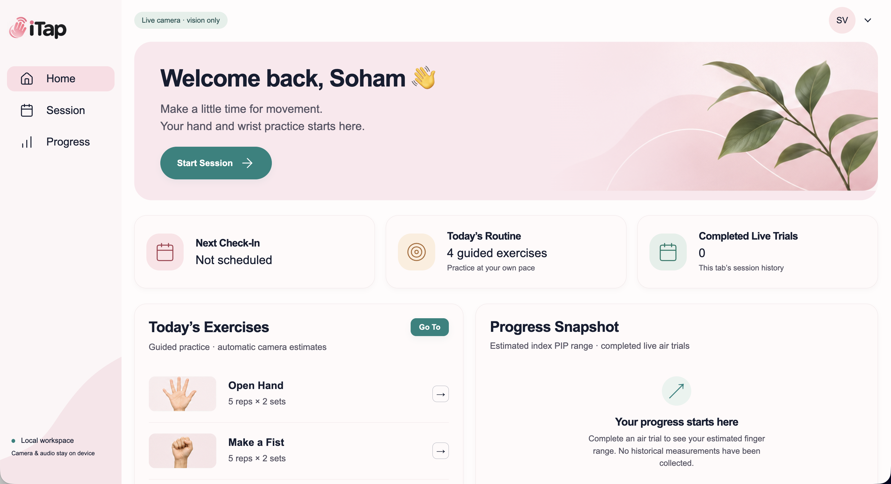

# ITap

Table 30

70% of hand therapy patients fail at-home regimens because they lack the ability to measure 2-3 degree range-of-motion improvements. Users may struggle to see changes in movement, notice compensatory motions, or share useful progress data with clinicians.

ITap is an ML assisted physical therapist that uses computer vision to judge your exercise form, and uses a novel spatial keyboard feature for transforming a standard laptop into an interactive physical therapy workstation. ITap guides users through calibrated sessions with real-time feedback.

ITap is a rehabilitation-inspired prototype designed to process camera and microphone data locally. It features:

- Live Digital Goniometry: Google MediaPipe tracks 21 hand landmarks to estimate finger joint flexion angles and range of motion in real time.
- Movement Guardrails: A deterministic vector-math engine that measures changes in palm orientation from a calibrated baseline, pausing target scoring and displaying feedback when deviation exceeds the configured threshold.
- Vibro-Acoustic Sensor Fusion (fancy talk for a spatial keyboard): Matches visual fingertip motion with microphone-detected impulses through the Web Audio API to measure desk-tapping speed, rhythm variability, and changes in tapping rate. Primarily used for hand exercises for Arthritis and Parkinson’s patients.

## Automatic guided routine demo

Open Session → Guided routine → Start camera. Follow the illustrated Now / Next cards and hold bar; there are no Record or Next clicks. Finish each held movement and return to the starting pose for one repetition. Two sets complete each exercise, then the next starts automatically. The final exercise returns to the completed checklist and stops devices.

- Open Hand: open all four fingers for 2 seconds, then close (5 repetitions × 2 sets).
- Make a Fist: start open, gently curl all four fingers for 0.5 seconds, then open again (5 × 2). This estimates four finger bends; thumb position and a full fist are not verified.
- Wrist Extension / Flexion: **palm-tilt proxy practice** (10 × 2 each). Support your forearm, hold an open neutral palm still for 1 second, tilt comfortably, hold briefly, then return. The camera does not verify wrist direction, anatomical wrist angle, or forearm support; whole-arm motion can resemble palm tilt.

Correction tips cover incomplete finger poses, sideways palm twisting, moving out of frame, insufficient hand size, uncertain tracking, and moving the hand away from its tilt reference. Tracking loss, stale frames, Pause, and a hidden tab clear the unfinished movement. Completed repetitions remain. Use Stop camera or leave Session to release devices. The routine checklist stays in this tab only and can also be edited manually.

The provisional thresholds live in `src/lib/guidedRoutine.ts`: enter open at ≤30° (remain open below 40°), enter curled at ≥60° (remain curled above 50°), palm tilt ≥18° with return ≤8°, and a 300 ms return hold. These are interaction defaults requiring live demo validation, not clinical targets. Existing timed air/desk trials and their acceptance gates remain separate.
